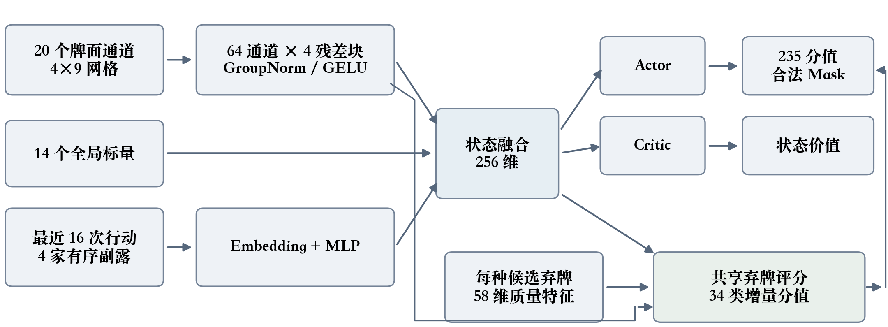
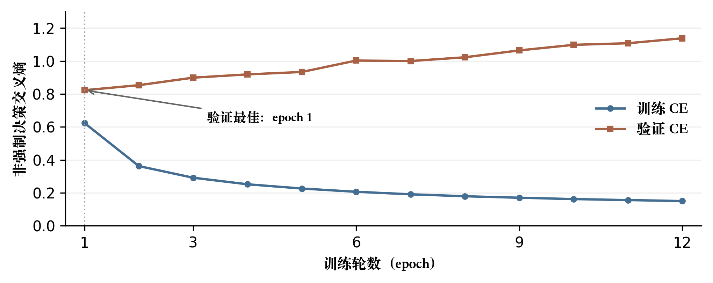

# 基于行为克隆与 PPO 强化学习的国标麻将智能体设计与实现

作者：【姓名】　学号：【学号】　日期：2026 年 11 月 20 日

## 摘要

国标麻将是具有隐藏信息、长时序决策与稀疏奖励的四人博弈。本文基于课程框架，实现行为克隆预训练与 PPO 强化学习相结合的智能体。通过公开行动历史、有序副露和候选弃牌质量特征，改进轻量残差网络；采用牌墙分组切分与复式对战控制数据泄漏和评估方差。V3 BC 的测试出牌准确率为 68.82%，综合对战奖励较同配方 D 提高 0.0621；短程 PPO 进一步取得小幅正向点估计，但差异尚不显著。最终完成 V3 短程 PPO 策略的 Botzone 部署。

**关键词：**国标麻将；行为克隆；PPO；公开状态特征；复式评估

## 1. 任务背景与问题建模

本项目采用四人、136 张无花牌、8 番起胡的国标麻将规则[1]。玩家只能观察自己的手牌和公开事件，无法直接获知对手手牌与未来摸牌；吃、碰、杠及弃牌还会影响后续收益。因此，任务既需要合法动作判断，也需要在不确定信息下权衡牌效、得分潜力与风险。

智能体以玩家可见状态为输入，在 235 维离散动作空间中决策。规则模块生成合法动作 Mask，屏蔽不允许的动作；训练与部署使用同一动作语义。环境按国标规则计算终局原始得分，奖励为该分数除以 32，非终局不额外塑形。目标是提高完整对局的期望奖励，而非仅提高和牌次数或专家动作复现率。

实现复用课程提供的环境、采样与 PPO 框架，并使用 PyMahjongGB 完成算番及牌型计算[2]。课程基础模型仅将手牌、座风和圈风编码为六通道，再由约 5.5 万参数的 CNN 输出策略与价值。项目先修复 BC 优化器遗漏主干参数及按单局切分造成的牌墙泄漏，再逐步扩展公开特征和网络，形成增强 ResNet 模型 D 与最终 V3。

## 2. 模型设计与方法

### 2.1 状态特征设计

仅凭手牌无法区分“同一张牌已被大量打出”与“仍有较多进张机会”等局面。D 将输入扩展为 34 通道，加入四家弃牌、副露牌计数、当前响应牌与来源、已公开和未见牌估计、剩余牌墙及阶段标志。V3 保留这些信息，将 20 个牌面通道与 14 个全局标量分开处理，减少卷积对重复标量的计算。

V3 进一步记录最近 16 次公开行动，编码行动者相对座位、类型与可见牌种；每家最多四组副露按形成顺序保存，区分吃、碰、明杠与暗杠，并编码牌种或顺子中张和相对来源。该分支补充累计计数丢失的顺序与结构信息，采用嵌入和轻量 MLP 处理，不引入大型序列网络。

对于每个合法候选弃牌，模型计算打出后的五类牌型向听数、有效进张种类及其未见张数估计，并结合对子、刻子、花色集中度、字牌等结构，构成 58 维质量向量。这些特征将可计算的牌效关系显式提供给网络，辅助其学习弃牌取舍。向听数和粗略番种潜力并不等于精确的 8 番可达性判断，不能替代规则算番。

新增信息均来自当前可见状态：对手暗杠牌种与公共摸牌事件中的牌种身份不予暴露，不读取对手暗手、未来牌墙或最终得分。回放、训练、Arena 与 Botzone Session 共用版本化编码；既有测试覆盖相对座位、吃碰复合动作、杠与抢杠、最后一张牌、隐藏信息扰动及冷启动重放的一致性。

### 2.2 神经网络架构

V3 采用 64 通道、4 个预激活残差块的牌面主干[3]，使用 GroupNorm[4] 与 GELU。主干特征与全局标量、行动及副露编码融合为状态向量；Actor 输出 235 个动作分值，Critic 输出标量价值。另设共享弃牌评分支路，将每种牌的局部表示、候选质量向量和全局状态融合，产生对应弃牌动作的增量分值，再统一施加合法 Mask。

*图 1　V3 网络结构。候选支路只修正 34 类弃牌分值，其余动作仍由 Actor 统一建模。*

模型共 1,199,917 个参数，D 为 966,444 个。V3 的重点是输入组织和动作相关融合，而非单纯扩容；它仍使用 4×9 网格，并未假定跨花色邻接完全符合麻将语义。既有本机 300 状态基准中，V3 BC 的特征计算均值约 0.590 ms、完整决策约 1.245 ms；这是原生牌效后端下的本地测量，不代表 Botzone 请求延迟。

### 2.3 BC 与 PPO 两阶段训练

BC 以专家状态–动作对预训练策略。设合法动作集合为 $A(s)$、网络分值为 $z_\theta$，采用合法集合内归一化的交叉熵：

$$
\mathcal{L}_{\mathrm{BC}}=-\frac{1}{N}\sum_{i=1}^{N}\log\frac{\exp z_\theta(s_i,a_i)}{\sum_{a\in A(s_i)}\exp z_\theta(s_i,a)}.
$$

优化器更新特征主干和策略相关参数，Critic 因缺少价值监督而不参与 BC 更新。仅一个合法动作的样本交叉熵及策略梯度均为零；实现可跳过其前向计算，但保留原完整批次分母，避免无意改变有效学习强度。

PPO[5] 从 BC 权重初始化，通过对局采集轨迹，以 GAE[6] 估计优势，其核心目标为：

$$
L^{\mathrm{clip}}(\theta)=\mathbb{E}_t\left[\min\left(r_t\widehat{A}_t,\operatorname{clip}(r_t,1-\epsilon,1+\epsilon)\widehat{A}_t\right)\right].
$$

其中 $r_t=\pi_\theta(a_t\mid s_t)/\pi_{\mathrm{old}}(a_t\mid s_t)$，新旧策略在同一合法动作集合上计算概率。实际最小化目标由负剪切目标、价值均方误差、负策略熵和 BC 参考 KL 组成：价值项系数为 0.5，熵项系数为 0.001，KL 系数为 1.0，方向为 $D_{\mathrm{KL}}(\pi_{\mathrm{BC}}\Vert\pi_\theta)$。KL 限制策略偏离已学到的专家行为，熵项维持适度探索。

为降低早期退化，每局设置两个轮换学习席和两个冻结对手席，对手在初始化 BC、历史 C、D 间混合。前 8 次迭代仅预热价值头，且价值分支输入停止梯度，避免随机 Critic 扰动共享主干；后续使用较小学习率更新策略，并按开发 Arena 保存最佳快照。

## 3. 数据与实验设置

BC 使用 IJCAI 2026 牌谱数据[7]，共 12,288 局、512 副独立牌墙、2,284,530 条决策样本。同一原始牌墙可能对应多个座位排列，因此按完整牌墙 SHA-256 分组，训练、验证、测试分别包含 410、51、51 副墙，对应 1,815,376、239,322、229,832 条样本。三个集合不共享牌墙；不同墙中的简单局面可产生相同编码，字节重复不等同于牌墙泄漏。测试集不用于本轮 checkpoint 选择。

主要对照为历史 D、同配方重训 D、V3 BC 及其短程 PPO。重训 D 与 V3 使用 Adam、学习率 0.001、批量 1024、梯度裁剪阈值 10，无标签平滑和权重衰减；均观察至少 12 个 epoch 的学习过程，按验证与开发对战选取快照。另比较 AdamW、预热与余弦衰减的联合配方，并对关键结论使用三个训练种子 20261119、20261120、20261121。实验在 Apple M5 Pro、24 GiB 内存、Python 3.10.22、PyTorch 2.3.1 环境进行，BC 使用 MPS，PPO 与 Arena 使用 CPU。

短程 PPO 每次迭代采集 16 局，学习率为 0.00002，剪切阈值 0.1，折扣因子 0.99，GAE 参数 0.95，每批轨迹更新 2 轮，mini-batch 为 512。整次实验执行 64 次迭代、1024 局、568 次优化器更新，约耗时 710 秒。最终提交权重选自 iteration 48，实际累计 768 局、422 次更新，其中前 128 局用于 Critic 预热；其 BC 初始化为 V3 第 1 epoch 快照，并非另一组 3072 局的长程 PPO。

动作准确率衡量模仿能力，完整对战奖励衡量策略效果。最终核心比较使用新的 500 副独立牌墙，每墙轮换四个座位，分别面对 Random、项目启发式 Teacher、历史 RL v1、C、D 五类冻结对手，每模型共 10,000 局。综合奖励对五类对手等权平均；95% 置信区间按牌墙聚类自助采样，同墙座位和对手先聚合，不能当作独立样本。开发与最终 Arena 分离，评估墙不与 BC 数据墙共享。Teacher 不代表课程官方 Baseline。

## 4. 实验结果与分析

### 4.1 核心模型对照

表 1 选取同一批固定对手评估结果[8]。D 重训版本对应第 6 epoch，V3 BC 对应第 1 epoch；历史 D 的训练运行共 3 epoch，发布的验证最佳权重同样在第 1 epoch。表中准确率针对测试集 57,222 个出牌标签，奖励不是 Botzone 线上成绩。

**表 1　核心对照：500 副墙、四座位轮换、五类冻结对手**

| 模型 | 参数量 | 测试出牌准确率 | 综合 Reward | Reward 的 95% CI |
| --- | ---: | ---: | ---: | --- |
| D-original | 966,444 | 65.09% | +0.1379 | [+0.1244, +0.1521] |
| D-retrained | 966,444 | 66.47% | +0.2172 | [+0.2005, +0.2344] |
| V3 BC | 1,199,917 | 68.82% | +0.2794 | [+0.2629, +0.2966] |
| V3 短程 PPO best | 1,199,917 | 68.92% | +0.2873 | [+0.2699, +0.3057] |

相对同配方重训 D，V3 BC 出牌准确率提高 2.35 个百分点，综合奖励提高 0.0621，配对差的 95% 区间为 [+0.0422, +0.0821]。该结果支持 V3 整体改进的收益。短程 PPO 相对 V3 BC 的奖励差为 +0.0079，区间为 [−0.0015, +0.0171]，仍跨越零，不能宣称显著提升。上述配对区间使用 20,000 次牌墙自助采样；三项预设比较的多重比较校正未改变这两项判断。

### 4.2 训练充分性与特征消融

重训 D 的表现说明原结构仍有训练和快照选择空间，但不能由此推断所有模型都应延长训练。图 2 显示，V3 主配方的非强制决策训练 CE 持续下降，验证 CE 却在第 1 epoch 达到最低 0.8232 后上升；第 12 epoch 二者分别为 0.1506 和 1.1384，呈现明显过拟合。整个 12 epoch 运行约 749 秒，最终保留早期泛化较好的快照。AdamW、预热及余弦衰减的联合方案也未自动优于原 Adam 配方，无法将差异单独归因于某个超参数。

*图 2　主种子 20261119 的 V3 BC 非强制决策 CE。训练值为各 epoch 更新过程中的均值，验证值为该 epoch 结束后的测量。*

在同一 AdamW 配方、128 副开发墙的探索性消融中，完整 V3 相对去除候选质量输入的奖励差为 +0.0750，95% 区间 [+0.0365, +0.1150]；这支持显式牌效特征的作用。历史与副露分支合并消融、GELU 与 ReLU 对照的区间均跨零，尚不能分别确认这些组件的独立收益。三个种子的原 Adam 配方开发比较中，V3 相对 D 的平均奖励差为 +0.0854，但只有三个种子，对初始化分布的推断仍有限。

### 4.3 结果解释与局限

当前证据更支持“充分利用公开信息和候选动作关系”，而非“参数越多越强”。V3 仅适度增加参数，却取得较明确的整体收益；继续增大网络缺少直接依据。训练数据虽包含大量决策，但仅来自 512 副独立墙，泛化仍受多样性约束。PPO 的稀疏终局奖励、有限对手分布与保守 KL 约束，可能限制短程更新幅度；正向点估计既不是显著改善的证明，也不能据此断言 PPO 无效。后续长程探索的独立确认仍存在增益不确定性。

## 5. 总结与讨论

项目完成了从专家牌谱 BC 预训练到受控 PPO 更新的完整流程，并通过牌墙分组、冻结对手、座位轮换和配对区间提高实验可信度。V3 将公开状态、候选弃牌质量与轻量 ResNet 融合，整体优于同配方重训 D；训练曲线同时表明，验证与真实对战应共同指导模型选择，不能用训练轮数或总体动作准确率替代策略质量。

提交版本保持了可核验的权重身份：V3 BC 是初始化与对照，最终策略为第四轮发布的短程 PPO 最佳权重。训练 checkpoint 与两次部署导出的参数逐项一致。当前兼容上传包的独立权重为 4,805,859 字节，小于 268,435,456 字节上限；代码 ZIP 为 16,615 字节，解压后共 45,816 字节，均小于 4,000,000 字节。模型与代码分开保存，既有部署记录覆盖完整对局、合法响应与历史重放。

最终将 V3 短程 PPO 策略部署至 Botzone 平台，完成提交并成功运行。

## 参考文献

[1] Botzone. Chinese-Standard-Mahjong：游戏规则与交互协议[EB/OL]. https://wiki.botzone.org.cn/index.php?title=Chinese-Standard-Mahjong.

[2] 北京大学人工智能实验室. MahjongGB：国标麻将算番组件及 Python 接口[CP/OL]. https://github.com/ailab-pku/MahjongGB.

[3] HE K, ZHANG X, REN S, et al. Identity Mappings in Deep Residual Networks[C]//ECCV. 2016. arXiv:1603.05027.

[4] WU Y, HE K. Group Normalization[C]//ECCV. 2018. arXiv:1803.08494.

[5] SCHULMAN J, WOLSKI F, DHARIWAL P, et al. Proximal Policy Optimization Algorithms[EB/OL]. 2017. arXiv:1707.06347.

[6] SCHULMAN J, MORITZ P, LEVINE S, et al. High-Dimensional Continuous Control Using Generalized Advantage Estimation[C]//ICLR. 2016. arXiv:1506.02438.

[7] Dannibal. ijcai-mahjong-corpora-2026：final2_all.jsonl.gz[DS/OL]. https://huggingface.co/datasets/Dannibal/ijcai-mahjong-corpora-2026.

[8] MahjongGB-RL-Lab 项目. 第四轮实验报告、原始日志与模型清单[CP/OL]. 开发提交 d830163；部署兼容提交 034b93f. https://github.com/zzyimpact/MahjongGB-RL-Lab.

**工具使用说明：**项目开发及报告整理使用 Codex 辅助；本报告数值依据既有源码、日志和评估记录核对，未为撰写报告新增训练或对战实验。Botzone 成功运行状态由提交者确认。
