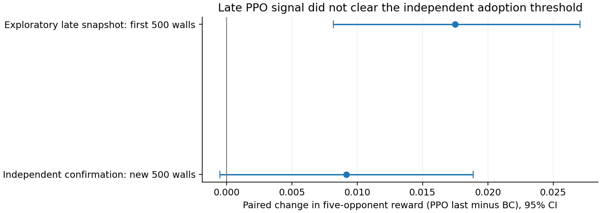

# 补充独立确认：固定长程PPO与BC

先保存确认计划，再执行新500墙、四座位、五冻结对手，共20,000完整局；本阶段未训练或改变权重。第一批最终池对late-snapshot选择只算探索性信息。

| 模型 vs 对手 | reward [95% CI] | 墙聚类SE | 胜率 | 负率 | 荒庄率 | 独立墙 |
| --- | --- | --- | --- | --- | --- | --- |
| PPO_extended_last vs C | +0.1455 [+0.1124, +0.1794] | 0.01738 | 27.35% | 51.00% | 21.65% | 500 |
| PPO_extended_last vs D | +0.1303 [+0.0980, +0.1633] | 0.01653 | 24.85% | 47.90% | 27.25% | 500 |
| PPO_extended_last vs random | +0.6071 [+0.5744, +0.6407] | 0.01658 | 45.10% | 0.60% | 54.30% | 500 |
| PPO_extended_last vs rl_v1 | +0.4951 [+0.4618, +0.5288] | 0.01734 | 39.05% | 12.95% | 48.00% | 500 |
| PPO_extended_last vs teacher | +0.1206 [+0.0856, +0.1558] | 0.01786 | 26.55% | 57.90% | 15.55% | 500 |
| V3_legacy_e01 vs C | +0.1434 [+0.1083, +0.1784] | 0.01811 | 27.00% | 51.00% | 22.00% | 500 |
| V3_legacy_e01 vs D | +0.1148 [+0.0834, +0.1467] | 0.01616 | 24.25% | 48.15% | 27.60% | 500 |
| V3_legacy_e01 vs random | +0.5861 [+0.5536, +0.6197] | 0.01694 | 43.75% | 0.65% | 55.60% | 500 |
| V3_legacy_e01 vs rl_v1 | +0.4862 [+0.4532, +0.5206] | 0.01735 | 38.40% | 13.15% | 48.45% | 500 |
| V3_legacy_e01 vs teacher | +0.1225 [+0.0867, +0.1578] | 0.01812 | 26.75% | 57.65% | 15.60% | 500 |

| 长程PPO−BC | 配对奖励差 [95% CI] |
| --- | --- |
| 五对手等权综合 | +0.0091 [-0.0005, +0.0189] |
| random | +0.0210 [+0.0001, +0.0427] |
| teacher | -0.0018 [-0.0237, +0.0200] |
| rl_v1 | +0.0089 [-0.0124, +0.0300] |
| C | +0.0021 [-0.0161, +0.0205] |
| D | +0.0155 [-0.0035, +0.0358] |

综合区间仍跨零，未通过预设采用门槛，推荐保持BC；这不是确定无效或等效性的证明。完整计划、SHA、逐局记录与统计保存在raw。

