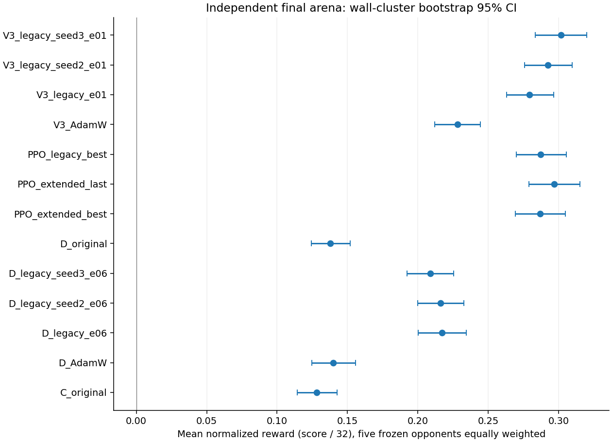

# 国标麻将 RL-Lab 第四轮最终技术报告

日期：2026-11-19。范围：本机实际开发、18组BC训练、4组PPO研究、冻结对手复式评估和独立权重/单文件部署。官方课程Baseline和真实Botzone线上环境没有访问或验证。

## 1. 项目演进与交付原则

V1使用55k小CNN，早期BC曾只更新Actor。第三轮修复完整Backbone训练与牌墙分组泄漏，建立C/D历史模型。本轮保留第三轮裁判、235动作语义、SeatView/Session和已验证的PPO核心，增加V3特征、1.20M结构化ResNet、训练充分性研究、对手混合与价值梯度隔离。

必须纠正历史预算与发布权重的区别：C/D各训练3 epoch，但实际发布的都是验证最佳的**第1epoch、1773次更新**权重。此事实直接读取历史checkpoint确认，未覆盖任何历史产物；见 `raw/historical_checkpoint_epochs.json`。

实际工作目录为 `/Users/zzy/Projects/MahjongGB-RL-Lab-v3-work`。原Desktop目录在本次工具环境中返回 `Operation not permitted`，未清理或覆盖。本轮工作从远程 `d150d3d7e9345642e76f62571cad21dc48b87294` 恢复，历史提交和产物仍保留。

## 2. 数据与可见信息边界

继续使用同一份IJCAI数据：12,288局、512副独立牌墙、2,284,530决策。严格沿用完整原始牌墙SHA-256分组：train/val/test为410/51/51墙，样本数为1,815,376/239,322/229,832。没有新增专家局，也不把24座位排列、重复训练或数据缓存计作新独立数据。

V3缓存只存非强制决策，分别576,202/75,685/73,294行；强制样本的真实类别数另存，其masked CE精确为0、准确率为1。原始全量顺序映射经过重新回放核验，让旧Adam配方可以保留完整1024行批次的分母和优化器更新次数。源数据、编码源码、原生库版本、缓存文件与分组均有指纹，旧缓存不会静默复用。

新特征仅使用自己手牌、公开事件、副露、合法动作和未见牌估计。对手暗杠牌种置零，所有公开历史中的摸牌身份都置零。没有使用对手暗手、未来牌墙、未来动作或比赛结果。完整状态定义、座位转换、边界情况和测试证据见 [ARCHITECTURE_AND_FEATURES.md](ARCHITECTURE_AND_FEATURES.md)。

训练集可见状态存在多标签：D的10.35%非强制行位于多标签状态，V3为8.76%。这可能反映专家随机性或尚未编码的上下文，不能直接判为坏标签，也不能当作隐藏信息泄漏证据。只有512独立专家墙仍是明确的数据多样性限制。

## 3. V3输入、架构与成本

- 保留D的34×4×9观察；20个牌面通道进入64宽、4块PreAct GroupNorm ResNet，14个全局量单独融合。
- 最近16个公开事件与4家×4个有序副露，以类别embedding和小MLP编码。
- 34×58候选弃牌向量，包括五类结构向听、有效牌种与未见张数、对子/刻子/单张和粗番种潜力。
- 共享弃牌增量评分与235维Policy Head融合；独立Value Head，合法动作mask不变。
- 1,199,917参数：共享主干/上下文1,065,984，策略100,908，价值33,025。D为966,444。默认GELU，另做ReLU对照。

结构向听不是8番起胡保证；粗番种特征没有未来得分标签。没有启用盲目花色置换：本机原生算番反例中，全绿相关条牌结构178番，条换万后96番，评分语义不等价。

单状态卷积/线性约12.712M MACs（约25.424M FLOPs，未计归一化、激活与牌效）。300个真实非强制状态CPU基准中，V3特征均值0.5896ms、完整决策1.2452ms；D分别0.1061ms、0.4965ms。V3约慢2.51倍，但本机绝对时间仍低。该基准与部署请求均值不同，不能用大量便宜PASS稀释非强制推理成本。精确分位数与测量范围在 `raw/model_benchmark_final.json`。

## 4. BC训练充分性与负面结果

完成18组实际BC运行，每组观察12epoch，共216epoch、316,800次优化器更新，BC作业累计9,691.10秒。作业耗时包含验证和快照；不同作业与Arena/PPO有并行，不能把总和当作整个任务墙钟时间。

主配方为AdamW、非强制batch512、5e-4学习率、warmup/cosine、WD.01、合法标签平滑.02。另做constant LR、更保守联合配方与旧Adam控制。**AdamW调度并没有自动胜过旧配方**。最终更强的V3来自旧Adam .001、完整顺序batch1024、无平滑/WD、clip10。配方同时改变多个条件，因此不能把收益单独归因于Adam、学习率或采样分母中的任意一个。

旧配方主seed的V3训练12epoch耗时749秒，验证NF CE最佳在第1epoch（0.82324）；以后训练CE持续下降，验证CE总体升高。最终保留第1epoch，不能把发布权重描述成第12epoch，也不能声称参数在第1epoch已经优化收敛。结论是本数据下较早快照泛化更好，而不是轮数越多越好。

D的同次旧配方训练中，第6epoch相对其验证最佳第1epoch的开发奖励差为+0.05072，95%区间[+0.01235,+0.08900]；第6相对第3epoch的区间跨零。因此不能笼统断言“过去3轮明显不够”。V3第3epoch相对第1epoch的开发差+0.01805，区间[-0.01808,+0.05519]，不支持换成更晚快照。

所有主要配方在12epoch已出现明显训练/验证分离，按预定规则早停，没有为了凑轮数跑20/30epoch。真实学习曲线和每epoch LR/梯度/更新数见 [TRAINING_STUDY.md](TRAINING_STUDY.md)。

## 5. 关键消融与多seed证据（开发数据）

下列结论来自128副共同开发墙、五冻结对手等权平均，不冒充最终独立确认。

| 主AdamW配方对比 | 奖励差 | 配对墙bootstrap 95%区间 |
|---|---:|---|
| V3 − 去掉候选质量信息 | +0.0750 | [+0.0365,+0.1150] |
| V3 − 去掉历史/副露上下文 | +0.0159 | [-0.0232,+0.0549] |
| V3 GELU − V3 ReLU | +0.0284 | [-0.0120,+0.0709] |
| V3 − D，同配方主seed | +0.0870 | [+0.0440,+0.1284] |

候选质量特征的收益有此开发实验支持；历史/副露分支与GELU各自的独立收益仍不确定。上下文消融同时去掉历史与副露结构，不能进一步拆分归因。候选特征消融保留评分网络、仅置零候选信息，不是减少参数量的容量实验。

三个训练seed为20261119/20/21。主AdamW配方V3−D的双层配对bootstrap均值+0.07448，95%区间[+0.04263,+0.10756]。旧Adam配方固定D第6epoch/V3第1epoch后，三seed差+0.08537，区间[+0.03501,+0.13620]。两种配方均支持V3整体方向，但只有三个seed，不能精确估计所有初始化分布。

旧配方V3三个seed开发均值分别0.30150/0.27344/0.34047；第三seed点估计最高，但相对主seed的配对区间[-0.00148,+0.08097]跨零，按事先规则保留主seed。没有每个seed事后挑不同epoch，也没有依据test挑seed。

## 6. PPO：实际训练与保护机制

本轮重新训练PPO，没有加载第三轮退化权重。两学习席轮换对两冻结席，冻结BC/C/D混合；Critic在共享状态入口detach，前128局只预热价值头，Actor逐tensor保持不变。使用lr2e-5、clip.1、entropy.001、2次PPO epoch、batch512，合法动作上的KL(BC || current)参考冻结。

完成4组研究运行，共执行6,144局、1,575,075玩家决策、3,466次更新，作业累计4,603.63秒。其中两个初始主配方控制各1024局、KL .2与1.0；更强旧Adam V3的新PPO1024局；最后相同配置扩展3072局。前两个控制共享1024墙，后两个共享前1024墙，**研究独立训练墙合计4096副**，另有8副仅用于流程smoke。扩展前1024局的全部策略tensor与短程实验逐一相等。

扩展实验真正完成192iteration、3072局、783,667决策、1732更新，2150.74秒；周期开发64墙的最高点在iteration112。短程运行的最佳在iteration48（768局、422更新）。所有原始BC、初始PPO、周期快照、周期最佳、eval-best及最后状态均保留。

在另一组共同128开发墙，短程best相对BC为+0.01488，区间[-0.00415,+0.03282]；扩展best相对BC约-0.00117，扩展last约+0.00724，均无可靠正增益。扩展没有给出稳定额外收益，因而停止继续加长，推荐仍为BC；短程iteration48作为真实PPO权重备选，长程best/last仍纳入最终冻结比较。

短程best在验证非强制状态上KL为0.00223，约2.21%贪心动作改变；扩展last为0.00311、约2.30%。这些数据证明策略确实更新，也说明更新较保守。不能据此断言KL太强是唯一原因；稀疏回报、对手覆盖和价值学习仍可能限制收益。本轮没有把价值隔离、对手混合等联合防护拆成独立因果试验。

初始两次pilot没有直接记录启动源码hash/子进程RNG恢复点，不能事后补造；最终候选及扩展实验已记录源码身份并启用episode独立随机种子。完整实际规模、loss、KL、对手组成和结果见 [RL_STUDY.md](RL_STUDY.md)；第二组确认的全部对手统计见 [CONFIRMATION_RESULTS.md](CONFIRMATION_RESULTS.md)。

## 7. 评估设计与封存

候选与推荐角色在 `raw/selection.json` 中封存SHA-256后，才读取本轮test分类指标并运行Final Arena。test沿用第三轮51墙，历史成绩已公开，因此不是整个项目从未见过的测试集，但没有参与本轮训练/超参/seed选择。

Final Arena固定13候选，使用112000000起500副新墙，每墙四座位，对Random、Teacher、RL v1、C、D五类冻结对手；每模型每对手2000局。对手是另外三席同一冻结策略，这是固定对手测试，不是四个不同模型的循环赛。模型行为可产生不同轨迹，相同牌墙不意味着动作序列相同。

所有区间按墙聚类；同墙四座位及五种对手先聚合，不当作独立样本。综合指标为五对手等权reward，reward=终局原始分/32。主要三项配对对比使用20,000次墙bootstrap，并另给Bonferroni区间；其余消融和seed比较为探索性边际区间。

原始牌墙哈希审计覆盖410/51/51 BC墙、保守排除的5874历史墙、292新开发墙、500最终墙及4104 PPO/流程墙，跨用途交集全为0。开发重复、PPO重复前缀不按新独立墙计数。最终结果不会触发新的调参。

## 8. 本地部署与测试范围

V3 BC、真实PPO备选和D兼容备选均导出单个 `mahjong_bot.py`、备用ZIP及独立 `mahjong_model.pt`。代码绑定对应权重SHA，不能混用版本。权重不得嵌入代码。

V3模型4,805,859bytes；BC ZIP12,320bytes、解压35,174bytes、单py38,181bytes；PPO ZIP12,319bytes，其他对应大小相同。D权重3,870,059bytes、ZIP12,283bytes、解压35,104bytes、单py38,111bytes。全部通过模型≤268435456bytes、代码各项严格<4000000bytes的自动门槛，资源清单没有训练缓存或checkpoint。

BC的ZIP与单文件各运行200完整局/29,798请求；PPO各32局/5,045请求；D各32局/4,956请求。各格式的响应逐条一致，均无非法动作，冷历史重放通过。这些是部署一致性测试，不是新增独立对战证据。BC单文件冷启动501.60ms，峰值RSS198,148,096bytes；PPO在Final Arena并行时冷启动747.36ms，峰值207,831,040bytes。全部精确分位数与资源清单见 [SUBMISSION_CHECK.md](SUBMISSION_CHECK.md)。

最终麻将测试43项通过；规则审计12/12；已有依赖的框架核心32通过、3项CUDA跳过。四个FDL集成测试因仓库缺模块/生成样例未通过，原始失败日志保留，不声称全仓库全绿。覆盖候选向听、隐藏信息扰动、Session一致性、吃碰/杠/补杠/最后墙、BC梯度、checkpoint严格加载、KL数学、critic隔离、episode随机种子、缓存拒绝、断点恢复和发布体积失败。

本机Python3.10.22/PyTorch2.3.1/PyMahjongGB1.4.0。Python3.6仅通过语法检查；V3要求平台具备五类原生向听API与GELU，缺失时明确报错。Botzone实际依赖、时间/内存额度和账号提交仍未验证，模型文件额度不能代替进程内存额度。可先上传BC做平台验证；若课程硬性要求最终权重经过RL更新，应使用PPO备选并诚实说明尚无可靠胜率改善。

长程PPO另导出 `PPO_long`，两种格式各200局、29,750请求、零非法；seed3的单文件/ZIP各32局、4712请求、零非法。所有格式的冷重放和逐响应一致性均通过，完整明细包括这些额外候选。

## 9. 可复现性和交付范围

数据、18组BC配置、4组PPO配置、随机种子、源码身份、完整学习曲线、逐局/逐墙Arena和性能数据均有记录。完整命令见 [REPRODUCIBILITY.md](REPRODUCIBILITY.md)。源数据SHA为 `f3565b2c5c27459abe5fb4bd1b867bc7d1faddd06dba857f6f216d3db4d484b1`。

发布的选定checkpoint保留优化器状态，导出权重只含推理参数；大缓存和全部未入选阶段快照留在本地 `data/final_v3`、`runs/final_v3`，不进入Git。`ARTIFACT_MANIFEST.json`记录每个模型、原始记录及无损gzip的SHA；`RELEASE_VERIFICATION.json`验证strict加载、封存身份、评估身份、资源大小和已保存运行验证。

一次开发Arena等待器误从stdin启动macOS多进程，尚未产生任何对局即失败；保留错误日志，终止该自有等待器后改用正式模块CLI和`--resume`完成。没有删除真实结果或用重跑覆盖坏分数；见 `raw/execution_recovery.json`。

## 10. 实际最终结果与第二组确认

第一批完成 **130,000场完整对局、500副独立墙**，耗时855.76秒；每模型每对手2000局。以下为代表性模型，完整13候选、每对手奖励/分差/胜负荒庄、样本数和全部类别准确率见 [RESULT_TABLES.md](RESULT_TABLES.md)。

| 模型 | Test Play | Test Nonpass | Test NF CE | Teacher reward | 五对手综合reward [95% CI] |
| --- | --- | --- | --- | --- | --- |
| C_original | 57.48% | 58.63% | 1.14882 | -0.04261 | +0.1282 [+0.1142, +0.1428] |
| D_original | 65.09% | 65.65% | 0.91774 | -0.02106 | +0.1379 [+0.1244, +0.1521] |
| D_AdamW | 63.21% | 64.40% | 0.97708 | -0.02730 | +0.1399 [+0.1247, +0.1558] |
| D_legacy_e06 | 66.47% | 67.82% | 1.03260 | +0.04036 | +0.2172 [+0.2005, +0.2344] |
| V3_AdamW | 64.81% | 65.75% | 0.91337 | +0.05352 | +0.2282 [+0.2119, +0.2444] |
| V3_legacy_e01 | 68.82% | 69.58% | 0.82373 | +0.11758 | +0.2794 [+0.2629, +0.2966] |
| V3_legacy_seed3_e01 | 68.72% | 69.42% | 0.83958 | +0.12098 | +0.3018 [+0.2836, +0.3200] |
| PPO_legacy_best | 68.92% | 69.69% | 0.82370 | +0.12955 | +0.2873 [+0.2699, +0.3057] |
| PPO_extended_last | 68.96% | 69.70% | 0.82556 | +0.14698 | +0.2968 [+0.2791, +0.3153] |

| 原预注册主要对比 | 奖励差 [95% CI] | 三项Bonferroni区间 |
| --- | --- | --- |
| V3_legacy_e01 - D_original | +0.1415 [+0.1221, +0.1608] | [+0.11767,+0.16497] |
| V3_legacy_e01 - D_legacy_e06 | +0.0621 [+0.0422, +0.0821] | [+0.03765,+0.08632] |
| PPO_legacy_best - V3_legacy_e01 | +0.0079 [-0.0015, +0.0171] | [-0.00358,+0.01900] |

V3主候选在五类冻结对手下的reward区间均高于0，包括Teacher +0.11758 [0.08226,0.15263]；这支持对这些指定冻结策略的优势，**Teacher并非官方课程Baseline**。相对同配方D的+0.06214以及相对历史D的+0.14148在主要比较校正后仍有支持。D重训第6epoch相对历史D为+0.07934，边际区间[0.06025,0.09900]；不是所有重训配方都有效，D_AdamW只为+0.13992。

V3 seed20261121在本批点估计最高（+0.30176）。相对主seed的边际95%区间[0.00260,0.04279]高于0，但这是多候选池中的探索性比较，不是原预注册的三项主对比；不能据此宣称已确认它在所有对手/初始化中最强。它另提供单文件部署版本，原先预选主候选及其主要确认结果不被改写。三个seed在开发与最终集合中的排名变化说明初始化/墙采样仍有影响。

长程PPO最后权重在第一批相对BC出现+0.01747 [0.00818,0.02706]的探索性信号，而预选短程PPO未显著。为不把同一集合既用来发现late snapshot又自证，另行锁定 `raw/supplementary_confirmation_plan.json`，使用 **113000000起500副全新墙**，只比较固定BC与固定长程last，未修改权重、特征或训练参数。该确认完成20,000场对局，耗时158.73秒。

| 新确认集合模型 | 五对手综合reward [95% CI] |
| --- | --- |
| PPO_extended_last | +0.2997 [+0.2830, +0.3171] |
| V3_legacy_e01 | +0.2906 [+0.2734, +0.3082] |

新500墙的长程PPO−BC为 **+0.00914062，95%区间[-0.00050016,0.01888133]**。预先规定的采用门槛是区间下界>0且没有对手的区间完全低于-.02；结果未通过。按计划结束研究，保留BC主推荐，不继续追求显著结果。不能把未显著解释成“PPO确定无效”，也不把两批合并后冒充独立确认。

共执行150,000场最终/补充确认对局，对应两个独立的500墙集合；不是150,000个独立统计样本。墙审计单列confirmation=500，与第一批final=500及所有开发/训练人口交集均0。

## 11. 13个研究问题的回答

1. **D过去3epoch明显不充分吗？** 不能笼统这样说。历史发布的是第1epoch；新D同次训练第6相对第1有开发收益，但第6相对第3尚不确定。重训第6在第一批新500墙显著优于历史发布版本，包含训练过程/快照选择差异，不把所有收益归因于轮数。
2. **更长训练和LR调度有多少收益？** 旧Adam D第6的最终综合reward较历史D高0.07934；AdamW/warmup/cosine联合方案没有优于旧配方。V3后期CE过拟合，未支持换成更晚BC。不能将联合配方差拆成单个超参的因果收益。
3. **哪些特征有效？** 候选弃牌质量信息有同配方消融支持；有序历史/副露结构的独立收益未确认。所有特征是可见状态推导，不是Teacher额外提示或新专家标签。
4. **V3优于充分训练D吗？** 主预注册比较在独立500墙上+0.06214，Bonferroni区间仍为正；两种配方的三seed开发结果也支持整体方向。不能因此声称每个新增组件都有效。
5. **过拟合、欠拟合还是数据多样性瓶颈？** 训练CE继续降低而验证CE升高，观察到过拟合；512独立专家墙及重复/多标签状态限制泛化。当前证据不支持简单解释为整体欠拟合。
6. **明显容量瓶颈吗？** 没有。约1.2M已能强拟合训练数据；更明确的问题是泛化、牌效/番种与防守表达、策略优化和评价噪声。
7. **需要扩至3M/10M吗？** 暂不建议，没有受控证据证明更大模型有收益。本轮没有运行此规模，也不伪造扩容结论。
8. **哪个seed/checkpoint表现最好？** 点估计最高为V3旧Adam seed20261121第1epoch；原预注册主候选为seed20261119第1epoch。二者须区分“观察排名”和“事先选择的确认对象”，都保留产物。多个seed只有3个，无法保证普遍排名。
9. **PPO能不明显损害BC并提升吗？** 当前保守方案没有重复第三轮明显退化；短程主比较未显著，长程last先出现正信号，第二组独立500墙仍略跨零。存在积极趋势，尚未达到预设稳定提升门槛。四组训练均真实执行。
10. **最终选哪个？** 主推荐仍为V3 BC主seed第1epoch。课程若要求最终权重必须RL更新，可使用3072局的PPO_long，明确其提升证据仍不充分；短程开发最佳也保留。不会把BC冒充RL模型。
11. **Botzone体积满足吗？** 已对真实文件检查，模型约4.81MB、单代码38,181bytes，ZIP及解压均远低于4,000,000bytes。线上Python/torch/原生API、时间/内存额度仍未验证。
12. **不增加BC数据还有什么方向？** 可检验更明确的8番可达与防守风险特征、针对决策的训练目标、更多独立RL seed/冻结对手覆盖和价值学习方案；这些是下一步假设，不是本轮已证实提升。无必要继续盲目增加BC epoch。
13. **能结束开发进入课程提交吗？** 可以停止本轮模型搜索，进入上传/平台兼容/官方Baseline验收。代码、可运行权重、真实BC+RL过程和公平评估已经具备；尚不能声称课程Baseline已被击败或Botzone线上已通过。

## 12. 最终推荐、资源与剩余条件

默认上传 `artifacts/round4/releases/BC/mahjong_bot.py`，独立权重为同目录 `mahjong_model.pt`。源checkpoint为 `artifacts/round4/V3_legacy_e01/checkpoint.pt`。备选及SHA见 [模型交付索引](../../artifacts/round4/README.md)。不要上传完整训练checkpoint代替部署权重。

本机M5 Pro、24GiB、MPS足以完成此次规模。18组BC累计约2.69作业小时，4组PPO约1.28作业小时；部分与评估并行，不把总和称作墙钟时间。最长单BC重复约18.1分钟，3072局PPO约35.8分钟，第一批130k局Arena约14.3分钟。现在没有必须申请远程GPU的证据；若未来扩大RL，应先按采样与learner实测瓶颈决定资源。

剩余验收条件明确：用户上传后核实平台依赖/运行限制；取得课程官方Baseline与统一对战标准；确认课程是否要求提交RL更新后的权重。如果严格要求RL策略，PPO_long是诚实的可运行备选，不能把“模型更强尚未确认”改写成已经超越Baseline。

本轮独立分支为 `codex/mahjong-v3-final`。实验源码commit在各run/manifest中保存；发布commit自身不能递归写进自身SHA，以 `git rev-parse HEAD` 和远程分支指针核验实际交付commit。最终回复给出实际push后验证的SHA和URL。
