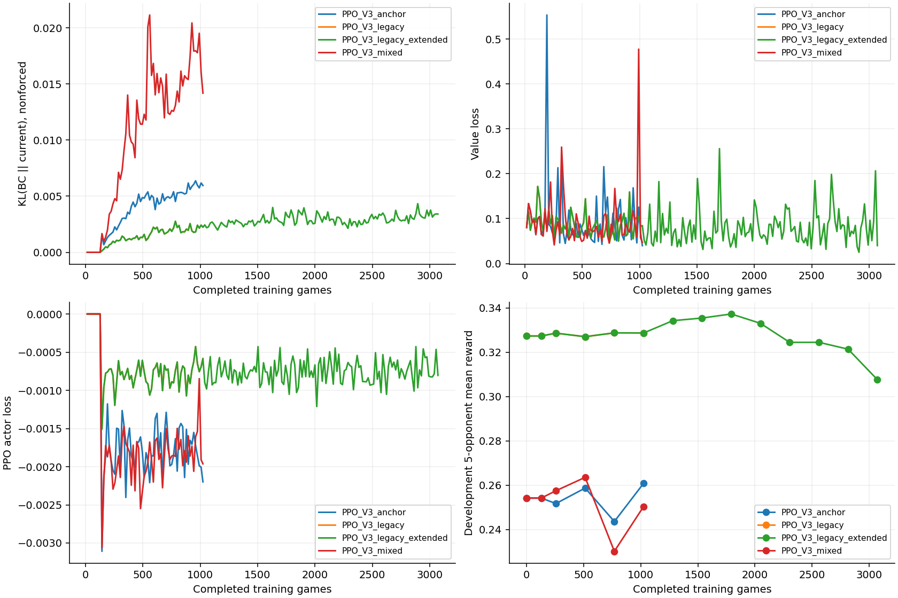

# 受控强化学习研究

本轮从新的 V3 BC 出发，未加载第三轮退化 PPO。保留原框架的 sparse collector、分玩家轨迹、GAE、固定 old-logp 与 clipped PPO objective。

每局两学习席轮转，其余两席由冻结 BC/C/D 按 seed 循环；不是四席实时共享策略。Critic 在共享状态输入处 detach，前8 iteration只训练价值头，Actor逐tensor保持不变。Actor更新学习率2e-5，clip .1，entropy .001，2 PPO epoch，batch512，每iteration16局。KL方向为 KL(BC || current)，只在合法动作上归一化，reference冻结。

初始两个控制实验只改变 KL 系数 .2→1.0。它们复用同一组1024训练墙，warmup权重逐tensor相同。两次执行的2048局不能称为2048副独立牌墙。统计学习席reward，不用零和四席均值证明牌力。

## 实际规模

| 实验 | KL系数 | 实际局 | 全部决策 | 学习席决策 | 更新 | warmup局 | 秒 | 非荒庄率 | 训练学习席平均reward |
| --- | --- | --- | --- | --- | --- | --- | --- | --- | --- |
| PPO_V3_anchor | 1.0 | 1024 | 266229 | 133118 | 576 | 128 | 846.9 | 72.56% | +0.003479 |
| PPO_V3_legacy | 1.0 | 1024 | 258479 | 129239 | 568 | 128 | 710.2 | 76.56% | -0.004349 |
| PPO_V3_legacy_extended | 1.0 | 3072 | 783667 | 391811 | 1732 | 128 | 2150.7 | 75.62% | -0.004807 |
| PPO_V3_mixed | 0.2 | 1024 | 266700 | 133362 | 590 | 128 | 895.8 | 72.46% | +0.000427 |

第三次 `PPO_V3_legacy` 从更强的旧Adam配方 V3 第1epoch重新开始，KL系数1.0；使用130010000起的新1024训练墙、110300000起的新64周期开发墙，并启用逐episode独立随机种子。它不是在前两次PPO权重上续训。主配置、源码commit及源码文件SHA由该次启动直接记录。

第四次 `PPO_V3_legacy_extended` 将相同配方扩展到最多3072局。为完整保留短程结果，它在新目录从相同BC重新运行，重复的前1024局不能当作新独立训练墙；前缀权重的实际核对见 `raw/ppo_extended_prefix_check.json`。它使用同一周期开发集，属于开发阶段扩展验证。实际停止位置以表中计数为准。

耗时含周期开发评估、不含最初 BC 基线评估；非荒庄率由每局两学习席终局reward重建。下面是warmup后每iteration指标的简单均值，不是按全体样本重加权的估计。

| 实验 | Actor loss | Value loss | Entropy | NF BC-reference KL |
| --- | --- | --- | --- | --- |
| PPO_V3_anchor | -0.001800 | 0.096215 | 0.211320 | 0.004264 |
| PPO_V3_legacy | -0.000803 | 0.084061 | 0.179672 | 0.001569 |
| PPO_V3_legacy_extended | -0.000771 | 0.080949 | 0.177737 | 0.002501 |
| PPO_V3_mixed | -0.001885 | 0.091917 | 0.211040 | 0.012108 |

每16 iteration以64开发墙、五冻结对手选 `ppo_best.pt`，另外保留 `last.pt`、周期快照、原始BC和包含BC的 `eval_best.pt`。128墙作开发比较，最终选择规则与候选SHA在新的500墙之前封存。

## 独立最终配对结果

| 候选 | 五对手综合reward [95% CI] |
| --- | --- |
| V3_legacy_e01 | +0.2794 [+0.2629, +0.2966] |
| PPO_legacy_best | +0.2873 [+0.2699, +0.3057] |

| 预注册差值 | 均值 / 95% CI | 三主要比较 Bonferroni 区间 |
| --- | --- | --- |
| PPO_legacy_best - V3_legacy_e01 | +0.0079 [-0.0015, +0.0171] | [-0.0036, +0.0190] |

PPO结果解释和是否采用见 FINAL_REPORT。未针对所有潜在退化原因做独立因果实验：价值隔离、对手混合、更小更新强度是联合防护，不能把与第三轮差异归功于其中一个组件。初始两次pilot未记录启动源码hash、也未保存子进程RNG恢复点，因此不能为其补造启动身份或承诺跨中断逐bit一致。第三次最终候选实验已直接保存源码身份并启用episode独立随机种子；仍不承诺跨平台浮点内核逐bit一致。

## 长程最后权重的额外独立确认

第一批最终池中，未被预选为PPO主候选的长程last相对BC出现+0.01747的探索性信号。没有将该结果改写成原预注册主假设；另行保存确认计划、锁定相同两个checkpoint，在113000000起500副全新墙上复验，无新训练/调参。

| 模型 | 另500墙综合reward [95% CI] |
| --- | --- |
| PPO_extended_last | +0.2997 [+0.2830, +0.3171] |
| V3_legacy_e01 | +0.2906 [+0.2734, +0.3082] |

| 独立配对差 | 奖励差 [95% CI] | 通过预设采用门槛 | 最终推荐 |
| --- | --- | --- | --- |
| PPO_extended_last - V3_legacy_e01 | +0.0091 [-0.0005, +0.0189] | False | V3_legacy_e01 |

采用门槛是配对95%区间下界>0，且没有对手的区间完全低于-.02。此次仍跨零，按计划结束研究并保留BC。未把第一批用于发现信号的500墙与新500墙混合后再声称独立确认；也不把未显著解释成确定无效。长程PPO另提供为真实RL备选。
