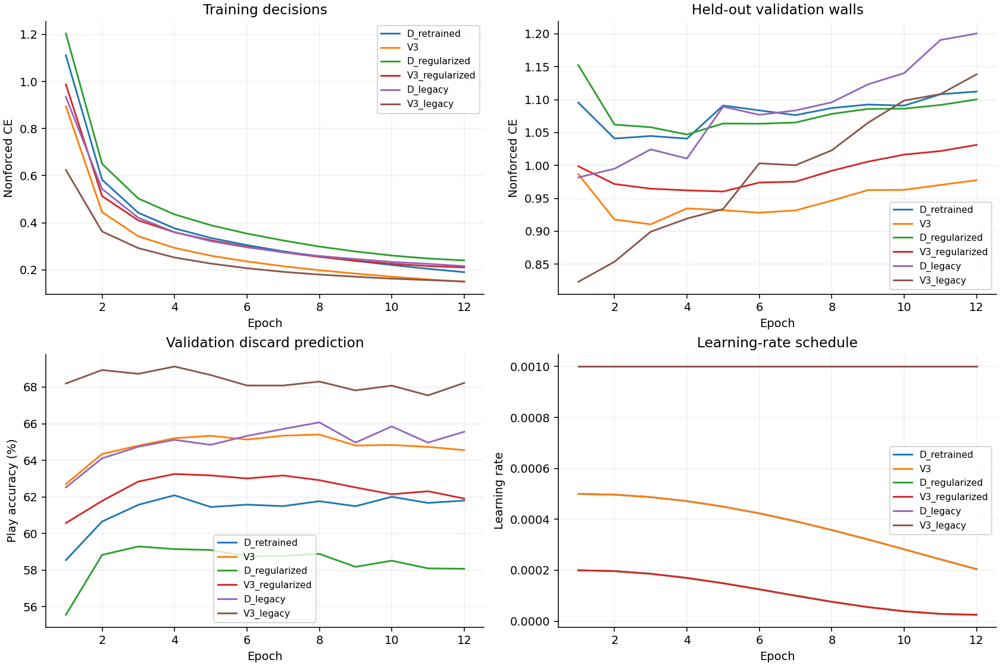
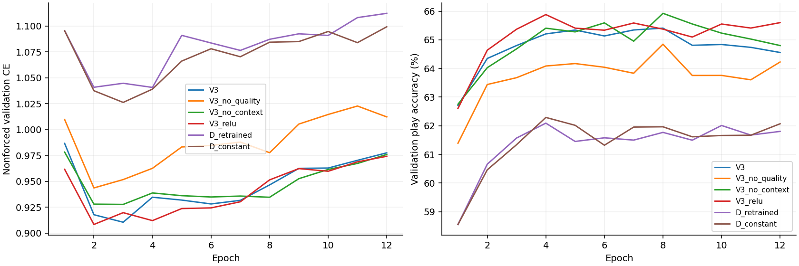

# BC 训练充分性研究

所有表由 `mahjong.report_tables_v3` 读取原始记录生成。CE 默认指非强制决策；全样本 CE 另保存在 JSON。测试指标仅在候选 SHA 封存后读取。

## 配方与选择

先纠正历史预算与发布状态的区别：第三轮C/D各训练3 epoch，但发布checkpoint均保留第1 epoch、1773更新的验证最佳权重。实际状态重新读取于 `raw/historical_checkpoint_epochs.json`，没有改写历史权重。

| 历史模型 | 训练epoch | 是否实际发布 | Val NF CE | Val Play |
| --- | --- | --- | --- | --- |
| C | 1 | 是 | 1.1964 | 55.33% |
| C | 2 | 否 | 1.2822 | 55.08% |
| C | 3 | 否 | 1.3735 | 55.49% |
| D | 1 | 是 | 0.9676 | 62.51% |
| D | 2 | 否 | 0.9726 | 64.38% |
| D | 3 | 否 | 1.0139 | 64.91% |

主配方使用 AdamW、非强制 batch512、5e-4 学习率、1 epoch warmup、20 epoch cosine 规划、weight decay .01、合法标签平滑 .02、clip5。至少观察12 epoch，验证 CE 改善需超过 .001，patience6。更保守配方联合改变 batch256/lr2e-4/smoothing.1，并在12 epoch衰减至floor；不是单变量因果试验。

D_constant 只去掉主配方 cosine。D_legacy/V3_legacy 使用旧 Adam .001、完整序列1024分批、无平滑/WD、clip10；从随机初始化重新训练。强制行没有有效梯度，因此只对同批非强制行前向，仍除原始完整批大小。全部训练集原始位置、mask、action经重新回放核验；GroupNorm逐样本梯度等价测试通过。不同批 shape/数值内核不承诺与历史运行逐bit相同。

## 全部实际 BC 运行

| Run | Seed | 参数 | 实际 epoch | 保留 epoch | 累计更新 | 保留 epoch Train NF CE | Val NF CE | Val Play | 秒 | 开发综合奖励 [95% CI] |
| --- | --- | --- | --- | --- | --- | --- | --- | --- | --- | --- |
| D_constant | 20261119 | 966444 | 12 | 3 | 13512 | 0.4449 | 1.0263 | 61.34% | 365.9 | +0.1617 [+0.1290, +0.1957] |
| D_legacy | 20261119 | 966444 | 12 | 1 | 21276 | 0.9346 | 0.9818 | 62.52% | 467.2 | +0.1747 [+0.1433, +0.2060] |
| D_legacy_seed2 | 20261120 | 966444 | 12 | 2 | 21276 | 0.5427 | 0.9630 | 65.04% | 565.9 | +0.1891 [+0.1593, +0.2197] |
| D_legacy_seed3 | 20261121 | 966444 | 12 | 2 | 21276 | 0.5527 | 0.9767 | 63.59% | 556.7 | +0.2037 [+0.1692, +0.2364] |
| D_regularized | 20261119 | 966444 | 12 | 4 | 27012 | 0.4355 | 1.0470 | 59.15% | 556.1 | +0.1104 [+0.0816, +0.1396] |
| D_retrained | 20261119 | 966444 | 12 | 2 | 13512 | 0.5826 | 1.0409 | 60.66% | 357.8 | +0.1472 [+0.1193, +0.1773] |
| D_retrained_seed2 | 20261120 | 966444 | 12 | 3 | 13512 | 0.4399 | 1.0256 | 61.81% | 304.8 | +0.1460 [+0.1166, +0.1740] |
| D_retrained_seed3 | 20261121 | 966444 | 12 | 2 | 13512 | 0.5723 | 1.0258 | 61.92% | 313.9 | +0.1569 [+0.1235, +0.1921] |
| V3 | 20261119 | 1199917 | 12 | 3 | 13512 | 0.3424 | 0.9106 | 64.80% | 494.9 | +0.2342 [+0.1960, +0.2728] |
| V3_legacy | 20261119 | 1199917 | 12 | 1 | 21276 | 0.6244 | 0.8232 | 68.20% | 748.6 | +0.3015 [+0.2647, +0.3389] |
| V3_legacy_seed2 | 20261120 | 1199917 | 12 | 1 | 21276 | 0.6288 | 0.8415 | 68.70% | 963.6 | +0.2734 [+0.2394, +0.3096] |
| V3_legacy_seed3 | 20261121 | 1199917 | 12 | 1 | 21276 | 0.6265 | 0.8252 | 68.79% | 1084.1 | +0.3405 [+0.3010, +0.3797] |
| V3_no_context | 20261119 | 1199917 | 12 | 2 | 13512 | 0.4529 | 0.9280 | 64.03% | 465.5 | +0.2184 [+0.1828, +0.2556] |
| V3_no_quality | 20261119 | 1199917 | 12 | 2 | 13512 | 0.4582 | 0.9437 | 63.44% | 521.6 | +0.1593 [+0.1240, +0.1955] |
| V3_regularized | 20261119 | 1199917 | 12 | 5 | 27012 | 0.3256 | 0.9604 | 63.18% | 646.7 | +0.1852 [+0.1533, +0.2180] |
| V3_relu | 20261119 | 1199917 | 12 | 2 | 13512 | 0.4937 | 0.9084 | 64.64% | 500.6 | +0.2058 [+0.1724, +0.2410] |
| V3_seed2 | 20261120 | 1199917 | 12 | 4 | 13512 | 0.2942 | 0.9192 | 65.13% | 382.4 | +0.2183 [+0.1831, +0.2548] |
| V3_seed3 | 20261121 | 1199917 | 12 | 3 | 13512 | 0.3433 | 0.9327 | 64.73% | 394.9 | +0.2210 [+0.1929, +0.2513] |

累计更新包含保留 checkpoint 之后的观察训练。`checkpoint.pt` 是验证规则选出的较早状态，`last.pt` 和阶段快照另存。BC 不优化无价值监督的 Critic。

## 3/6/12 等阶段

| Run | Epoch | Train NF CE | Val NF CE | Val Play | LR | 梯度范数（裁剪前均值） | 更新 |
| --- | --- | --- | --- | --- | --- | --- | --- |
| D_retrained | 3 | 0.4423 | 1.0447 | 61.57% | 0.0004871 | 2.805 | 3378 |
| D_retrained | 6 | 0.3049 | 1.0836 | 61.58% | 0.0004234 | 2.114 | 6756 |
| D_retrained | 12 | 0.1899 | 1.1123 | 61.80% | 0.0002042 | 1.570 | 13512 |
| V3 | 3 | 0.3424 | 0.9106 | 64.80% | 0.0004871 | 1.929 | 3378 |
| V3 | 6 | 0.2357 | 0.9282 | 65.14% | 0.0004234 | 1.313 | 6756 |
| V3 | 12 | 0.1491 | 0.9776 | 64.56% | 0.0002042 | 0.910 | 13512 |
| D_constant | 3 | 0.4449 | 1.0263 | 61.34% | 0.0005000 | 2.813 | 3378 |
| D_constant | 6 | 0.3157 | 1.0781 | 61.32% | 0.0005000 | 2.063 | 6756 |
| D_constant | 12 | 0.2348 | 1.0993 | 62.07% | 0.0005000 | 1.421 | 13512 |
| D_regularized | 3 | 0.5029 | 1.0580 | 59.30% | 0.0001861 | 4.241 | 6753 |
| D_regularized | 6 | 0.3540 | 1.0634 | 58.76% | 0.0001250 | 3.570 | 13506 |
| D_regularized | 12 | 0.2400 | 1.1002 | 58.08% | 0.0000250 | 3.120 | 27012 |
| V3_regularized | 3 | 0.4102 | 0.9646 | 62.84% | 0.0001861 | 2.966 | 6753 |
| V3_regularized | 6 | 0.2976 | 0.9740 | 63.01% | 0.0001250 | 2.389 | 13506 |
| V3_regularized | 12 | 0.2102 | 1.0313 | 61.91% | 0.0000250 | 2.156 | 27012 |
| D_legacy | 3 | 0.4213 | 1.0244 | 64.74% | 0.0010000 | 0.517 | 5319 |
| D_legacy | 6 | 0.2954 | 1.0769 | 65.33% | 0.0010000 | 0.397 | 10638 |
| D_legacy | 12 | 0.2158 | 1.2004 | 65.56% | 0.0010000 | 0.299 | 21276 |
| V3_legacy | 3 | 0.2922 | 0.8993 | 68.73% | 0.0010000 | 0.305 | 5319 |
| V3_legacy | 6 | 0.2068 | 1.0033 | 68.09% | 0.0010000 | 0.224 | 10638 |
| V3_legacy | 12 | 0.1506 | 1.1384 | 68.23% | 0.0010000 | 0.165 | 21276 |

## 多 seed

| 模型族 | 三 seed 开发均值 | seed 标准差 | 双层 bootstrap 95% CI |
| --- | --- | --- | --- |
| D | +0.1472, +0.1460, +0.1569 | 0.0060 | [+0.1253, +0.1774] |
| V3 | +0.2342, +0.2183, +0.2210 | 0.0085 | [+0.1959, +0.2559] |

| 差值 | 均值 | 双层95% CI |
| --- | --- | --- |
| V3 - D | +0.0745 | [+0.0426, +0.1076] |

### 旧 Adam 配方的独立训练 seed 复验

开发阶段先在主seed比较阶段，再固定 D 第6epoch、V3第1epoch复验其他seed；不能为每个seed事后挑最好的阶段。下表与上面的AdamW族分开。

| 模型族 | 三 seed 开发均值 | seed 标准差 | 双层 bootstrap 95% CI |
| --- | --- | --- | --- |
| D | +0.2254, +0.2256, +0.2083 | 0.0100 | [+0.1907, +0.2495] |
| V3 | +0.3015, +0.2734, +0.3405 | 0.0337 | [+0.2632, +0.3509] |

| 差值 | 均值 | 双层95% CI |
| --- | --- | --- |
| V3 - D | +0.0854 | [+0.0350, +0.1362] |

阶段选择的原始配对区间保存于 `raw/legacy_stage_selection_evidence.json`；各seed的验证CE最优epoch可能与固定的Arena比较epoch不同，表中二者不能混淆。

仅三个训练 seed；双层bootstrap同时重采样配对训练 seed 和共同墙，不能精确代表所有初始化的分布。没有将三次训练当作新增专家数据。训练与验证差距、早停和开发 Arena 的综合解释见 FINAL_REPORT。未运行的20/30 epoch不填入表中。
